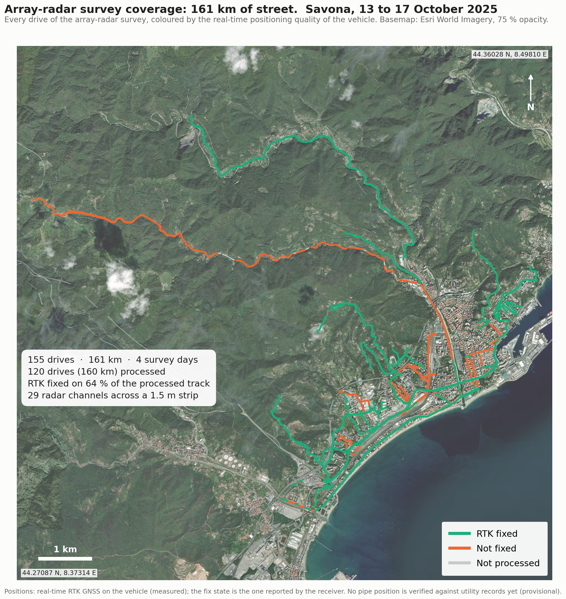

# ItalGas Savona: buried-pipe localisation from array GPR

Code and results for locating gas pipes in plan view from the IDS GeoRadar Stream UP array radar survey of Savona
(13 to 17 October 2025, 155 drives, 161 km of street). Two detectors run on the raw radargrams: one for pipes that run
**along** the street under the vehicle, one for pipes that **cross** the street. Both measure how much a candidate stands
out from the same data with the cross-antenna geometry scrambled, and the result is an interactive web map.

**Status (9 November 2026): provisional.** No ground truth has been obtained from ItalGas yet, so every position below is
a radar-only estimate checked only against independent passes of the same vehicle and against municipal sewer records.

## Results at a glance

| | along-street pipes | crossing pipes |
|---|---|---|
| drives processed | 120 of 155 (160 km; the other 35 are stubs under 100 m) | 14 of 120 (36 km) |
| detections | 1,890 line segments, 39.3 km | 3,048 crossings (1,024 seen by both radar rows, 2,024 by one row) |
| independent check | 20 % of covered line length is repeated by a drive in another lane on held-out streets, vs 1 to 4 % when that lane's lines are shifted (E50) | both radar rows agree on 32 % of 600 MHz crossings vs 0.7 % by chance (E39) |
| depth range | 0.5 to 1.3 m to the top of the reflector (0.10 m/ns) | 0.2 m to the signal floor |



Figures kept in `figures/`: survey coverage and positioning quality (`investor_coverage_savona.png`), the street-level result
(`team_street_pipes.png`), the held-out rule comparison (`rule_compare.png`), the near-surface artefact that fixed the depth
floor (`near_surface_floor.png`), an evidence raster of one drive (`savona_prob_raster_49_1800.png`), raster versus lines
(`savona_green_vs_lines_nizza.png`), the lane-agreement test (`savona_mosaic_*_nizza.png`), the crossing map of Via Nizza
(`savona_pipelines_map_vianizza.png`) and the instrument geometry (`savona_swaths_antenna_geometry.png`). Method schematics
are in `figures/report/`; the written method is `docs/ItalGas_Savona_pipe_detection_method.pdf`.

The interactive map (`figures/web/savona_pipes_map.html`, one self-contained file) shows the evidence raster, the derived
lines with their second-lane confidence, the crossings, drive footprints and the municipal records, with the radargram
behind every detection one click away.

## Repository layout

```
pipeline/            the working chain (Python 3.11, NumPy/SciPy), one module per concept
  paths.py             data locations ($ITALGAS_DATA), the only place a folder is defined
  ids_reader.py        IDS Stream UP file formats (.data, .index, .path, .nmea), reverse engineered
  geometry.py          vehicle frame <-> Web Mercator <-> lon/lat
  build_cube.py, build_v2.py, processing.py     per-swath geometry, preprocessing, gridding
  longitudinal.py, prob_raster.py, run_prob_rasters.py, raster_lines.py, rule_compare.py   along-street chain
  crossings.py, run_crossings_v2.py, finalize_v2.py, citywide_scan.py, citywide_merge.py   crossing chain
  survey_pairs.py, mosaic_fast.py, mosaic_test.py   repeat-lane registration and agreement test (E47)
  evidence_images.py   radargram images for the web page popups
  configs/             YAML configs (every threshold lives here, with its justification)
  tests/               unit tests with known answers (pytest)
figures/             result figures and their scripts; figures/web/ builds and hosts the web map
docs/                method report (PDF + builder), literature review, ground-truth sources
data_public/         Comune di Savona open data (CC BY 4.0), used as an independent check
archive/             experiment code that did not enter the working chain (see archive/README.md)
DECISIONS.md         dated design decisions with reasons (coordinate frame, velocity, thresholds, splits)
EXPERIMENTS.md       log of every experiment: date, config, data subset, metric, conclusion
REFERENCES.md        literature used, with what was taken from each source
CLAUDE.md            project rules (scientific rigour, code standards, terminology)
```

## Setup

```bash
conda create -n italgas python=3.11 && conda activate italgas      # or any Python 3.11 environment
pip install -r requirements.txt
```

All data lives outside the repository under one folder, `~/ItalGas` by default. Set `ITALGAS_DATA` to use another disk:

```bash
export ITALGAS_DATA=/Volumes/data/ItalGas      # optional; default ~/ItalGas
mkdir -p "$ITALGAS_DATA/Savona" "$ITALGAS_DATA/cache"
```

Configs refer to `${ITALGAS_DATA}/Savona` and `${ITALGAS_DATA}/cache`; `pipeline/paths.py` expands them.

### Raw data from S3

The survey is stored as one zip per DataLogger session in the bucket `smart-auger-italgas-ingest-286665918804`
(AWS profile of your own; the credentials file is not part of the repository). Download and unzip so that each session
folder sits directly under `Savona/`:

```bash
aws s3 sync s3://smart-auger-italgas-ingest-286665918804/ "$ITALGAS_DATA/zips/" --profile <your-profile>
cd "$ITALGAS_DATA/zips" && for z in *.zip; do unzip -q "$z" -d "$ITALGAS_DATA/Savona/"; done
```

Expected layout (the session folder name is the zip name without `.zip`):

```
$ITALGAS_DATA/Savona/
  savona 13.10.2025 matt_2025.10.13_09.51.03/
    Survey_2025-10-13_10-01-51/
      Swath001.path  Swath001.index  Swath001_Array01.data  Swath001_Array02.data  Swath001.nmea  Swath001_Ext.nmea ...
  savona 14.10.2025 matt_2025.10.14_10.25.22/
  ...
```

Sizes: 84 GB unzipped raw data; the cache grows to about 45 GB for the whole survey. The **drive index** used in every
cached file name is the position of the swath in the sorted list of `Savona/*/Survey_*/Swath*.path`, so do not add or
remove session folders between steps.

Check the installation (reader, geometry, detector metrics, 27 tests, a few seconds):

```bash
cd pipeline && python -m pytest -q tests
```

## Running the pipeline

All commands run from `pipeline/`. Every step skips drives it has already done, so a run can be stopped and resumed.
`<n>` is the number of parallel worker processes; see the compute notes below for sensible values.

### Step 0: drive tracks (needed by both detectors)

```bash
python build_swath_tracks.py configs/citywide.yaml        # -> cache/swaths.npz: every drive's RTK track, one entry per swath
```

### A. Along-street pipes (evidence raster, lines, confidence)

```bash
python survey_pairs.py                                    # which drives repeat which street in another lane -> cache/city/lane_components.json
python run_prob_rasters.py <n> all                        # evidence raster per 600 m piece of every drive -> cache/prob_raster_<drive>_<s0>.npz
python mosaic_fast.py <n>                                 # lane registration and two-lane agreement test (E47) -> cache/city/lane_<ref>.npz, lane_summary.json
python raster_lines.py <n>                                # raster -> lines by the rule in configs/raster_lines.yaml -> cache/city/rline_<drive>.json, raster_lines.json
python rule_compare.py <n>                                # optional: held-out comparison of 54 line rules (E50) -> cache/city/rule_compare.json
python evidence_images.py <n> lines                       # radargram image per line for the web page -> cache/web_evidence/lines/
```

What each step does is in the module docstring; the thresholds and their reasons are in `configs/raster_lines.yaml`
(line rule) and `configs/prob_raster.yaml` (raster). The raster of one piece can be inspected alone:
`python prob_raster.py configs/prob_raster.yaml <drive> <piece start m>`.

### B. Crossing pipes

```bash
python citywide_scan.py configs/citywide_scan.yaml --workers <n>    # both radar rows, every drive -> cache/city/scan_<drive>.json (+ _frame.npz)
python citywide_merge.py configs/citywide_scan.yaml                 # checks C1..C4, repeat-drive labels -> cache/city/citywide_merged.json
python evidence_images.py <n> crossings                              # radargram image per crossing -> cache/web_evidence/crossings/
```

`citywide_scan.py` works through the drives longest first and writes one JSON per drive; drives with an error are retried
on the next run. The optional along-street *track* branch of the same scanner (`configs/citywide_along.yaml`) only feeds
check C3 of the merge and is not needed for the map.

### C. The web map

```bash
cd ../figures/web
ln -s "$ITALGAS_DATA/cache/web_evidence" evidence         # once; the page links the radargram images from here
python build_savona_pipes_web.py savona_pipes_map.html    # one HTML file with every layer and check
```

Open the file in a browser (the basemap tiles and the Leaflet library load from the internet). To host it on claude.ai,
where the page may only load images published with it, `host_savona_pipes.py` replaces the satellite basemap by
OpenStreetMap vectors (query in `osm_query.txt`, ODbL) and packs the images into sprite sheets:

```bash
curl -s -A "your-project/1.0" -o osm.json --data-urlencode "data@osm_query.txt" https://overpass-api.de/api/interpreter
python -I host_savona_pipes.py osm.json <output folder>   # -> index.html, base/base.json, evidence/*.webp, raster/*.png
```

### D. Figures

Each script in `figures/` writes the PNG next to it and prints the numbers it used; run from `figures/`:
`python investor_coverage_savona.py`, `python team_street_pipes.py`, `python plot_rule_compare.py`,
`python plot_near_surface_floor.py`, `python plot_prob_raster.py <drive> <piece>` and so on (usage in each docstring).
`docs/build_method_report.py` rebuilds the method PDF from the figures and the cached results.

## Method in brief

**Along the street.** The 19 channels of the 200 MHz row are cleaned (day signature removed, noise equalised), gridded
every 5 cm and averaged over 2 m windows every 0.5 m. Across the street the window is focused with the measured antenna
positions (velocity 0.10 m/ns, derived from hyperbola fits); a pipe becomes a compact spot, a layer a line. The score of a
cell is the spot minus its brightest continuation to either side. The antenna order is shuffled 8 times and the score
recomputed; the evidence value P of a cell is 1 minus the share of cells at that score that the shuffled data also
produces. Cells with P >= 0.5 that are local maxima are chained window to window within 0.20 m sideways and 2 ns in
depth, bridging up to 4 m; chains of 10 m or more are lines. A line is *high* confidence when a drive in another lane
shows P >= 0.5 at the same ground position on at least half of its length, *medium* when no other lane covers it,
*low* when another lane covers it and does not repeat it. The top 0.33 m and the outer 0.2 m of the array are not
evaluated (instrument artefacts, DECISIONS 2026-11-04/05).

**Across the street.** Each channel of both rows is migrated along the street at four velocities (pipe angles up to
60 degrees from perpendicular). For every position, depth and angle the channels are shifted by lateral offset times
the tangent of the angle and averaged with the brightest quarter dropped, minus the brighter flank 0.6 to 1.5 m away.
Whole antenna columns are shifted independently along the street 8 times to get the chance level; candidates with an
estimated false-discovery proportion of 0.05 or less are kept, and a 600 MHz and a 200 MHz candidate within 0.3 m,
15 degrees and 0.2 m depth become one "both rows" crossing.

Full description with figures: `docs/ItalGas_Savona_pipe_detection_method.pdf`. Every rule and its reason:
`DECISIONS.md`. Every number quoted above: `EXPERIMENTS.md` (E39, E47, E50, E51).

## Compute and storage

Measured on a 2024 MacBook (8 cores, 16 GB) with the whole survey:

| step | cost | parallelism |
|---|---|---|
| evidence raster | 33 s per 600 m piece, single thread (8 shuffles are 63 % of it); 322 pieces = about 3 h CPU, 40 min with 5 workers | one process per piece; **5 workers maximum on 16 GB** (about 2 GB each; 7 workers thrashed swap) |
| raster to lines | about 3 min for 120 drives | one process per drive |
| rule comparison (optional) | 92 s with cached peaks; the first run also computes the peaks (14 s per threshold level on 18 drives) | one process per drive and threshold |
| crossing scan | 550 s per km of drive, single thread; 124 km remaining = about 19 h CPU, 5 h with 4 workers | one process per shard of drives (`--workers`) |
| evidence images | about 11 min for 5,500 images | one process per drive |
| web page | about 4 min | single process |

Where more speed would come from, in order of gain (not implemented, numerics unchanged):
the 8 shuffled migrations of a raster piece are independent and could run in a thread pool inside the piece process
(NumPy releases the GIL), but on an 8-core machine the piece-level parallelism already uses the cores, so the real limit
is memory per worker; the contrast score (`longitudinal.point_vs_line_contrast`) builds 84 shifted copies of the window
array with `np.roll` and could use strided views; the crossing scan migrates 29 channels at 4 velocities in a Python
loop over channels and would gain most from a machine with more memory and workers. A 64 GB machine runs the whole
survey in a few hours.

## Caveats

- Positions come from the real-time RTK track moved 1.19 m forward (an assumed timing bias, E25); they can be out by
  0.3 to 1 m or more. The post-processed trajectory is below 10 cm standard deviation for only about a quarter of epochs.
- No detection has been verified against the gas network map. Agreement between independent lanes and between the two
  radar rows is the only check available so far.
- Municipal records in `data_public/` are sewer and storm-water pipes (CC BY 4.0, Comune di Savona), used as a sanity
  check, not as ground truth. OpenStreetMap data used by the hosted map is ODbL.
- Raw data, caches and credentials are never committed; see `.gitignore`.
